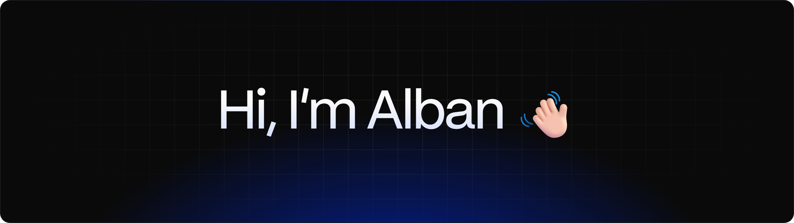
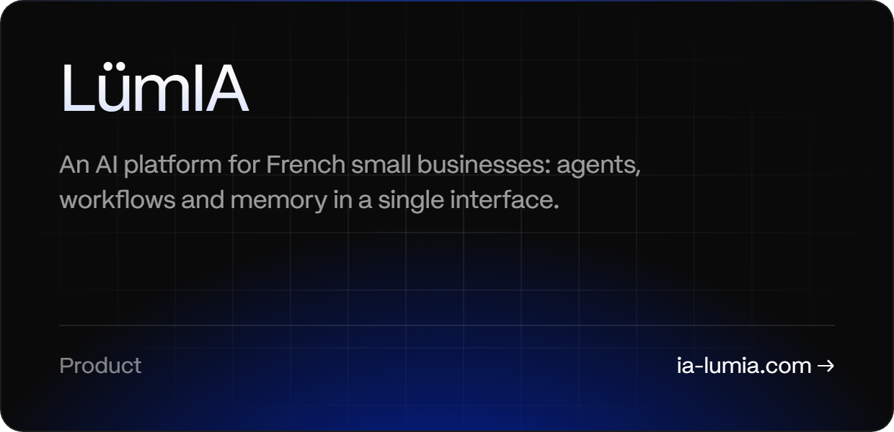
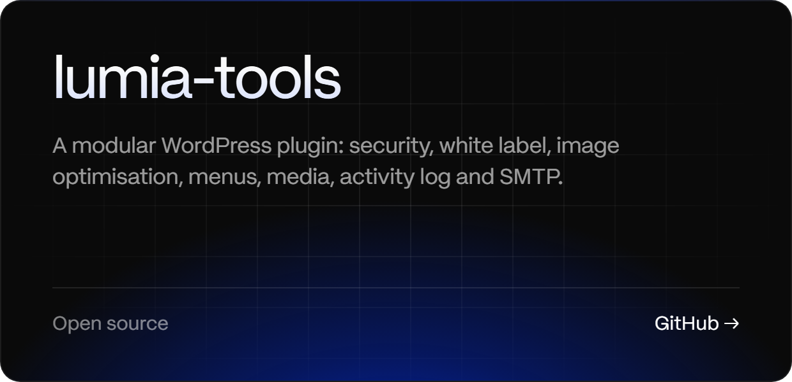
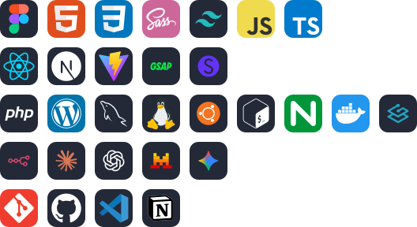
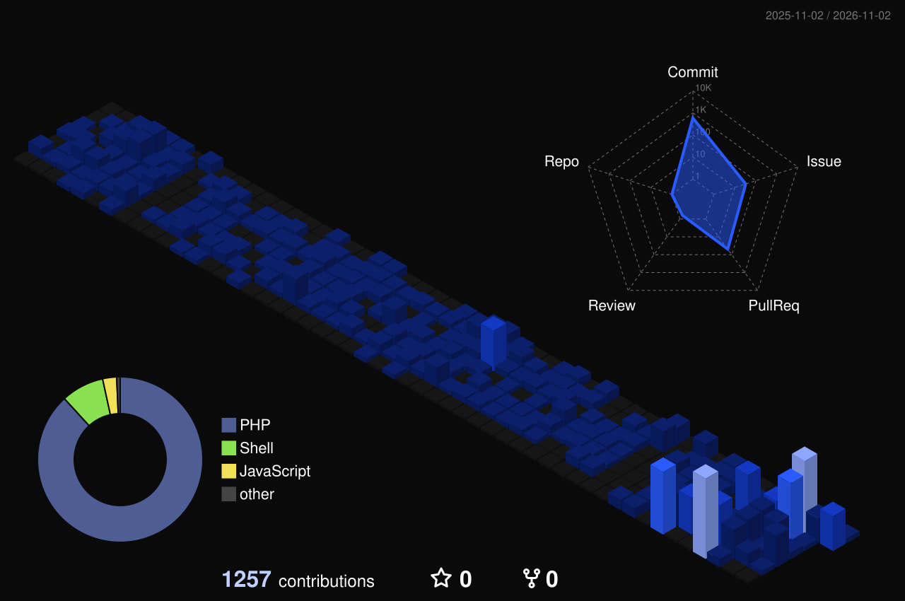

Designer & web developer based in France, currently at [Agence Lümia](https://github.com/agence-lumia).

#### What I do

**Design**: interfaces and websites, from Figma to the last pixel. 
**Build**: WordPress, Bricks, PHP and JavaScript. 
**Automate**: workflows and AI for small businesses.

#### Projects

#### Stack

#### Learning

#### Activity

  

  <a href="https://www.linkedin.com/in/alban-minana/">LinkedIn</a> · <a href="https://ia-lumia.com">ia-lumia.com</a> · <a href="https://github.com/agence-lumia">@agence-lumia</a>

